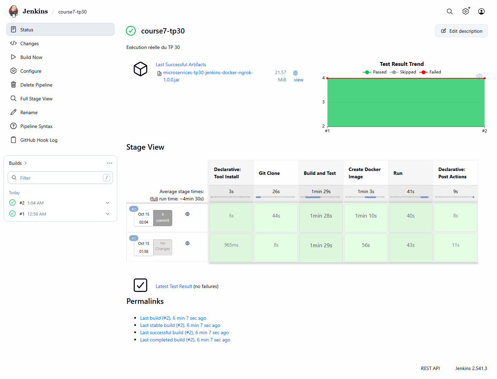
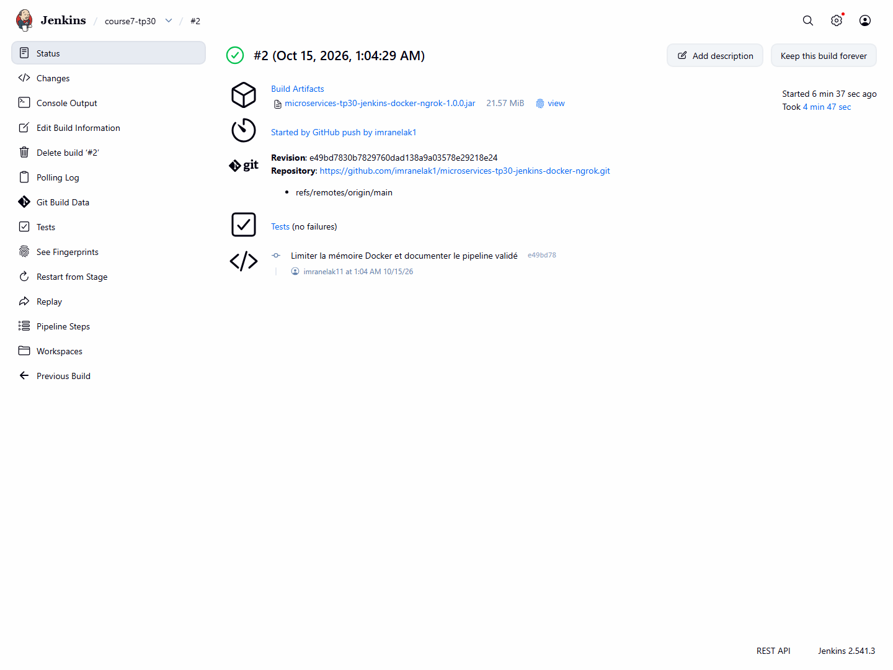

# TP30 — Pipeline Jenkins

 J'ai repris les routes du projet [jenkins de Lachgar](https://github.com/lachgar/jenkins). Le pipeline récupère mon dépôt, compile et teste l'application, construit l'image Docker puis la démarre avec Compose. Les tests sont publiés dans Jenkins et le JAR est archivé. Le déploiement peut être relancé sans conflit de nom de conteneur.

 ```sh
 mvn clean verify
 docker compose up -d --build --wait
 ```

 L'application est sur `http://localhost:18530`. Dans Jenkins, Maven doit s'appeler `maven`. Le `Jenkinsfile` fonctionne avec un agent Windows ou Linux disposant de Docker. La configuration ngrok et GitHub est décrite dans `WEBHOOK.md`. Les secrets restent dans Jenkins et ngrok. Un push doit produire une livraison webhook HTTP 200 puis une nouvelle exécution du pipeline ; les traces réelles de validation sont conservées dans `evidence/`.

 Les traces d'exécution sont dans `evidence/` et les captures dans `screenshots/`.

 
 
